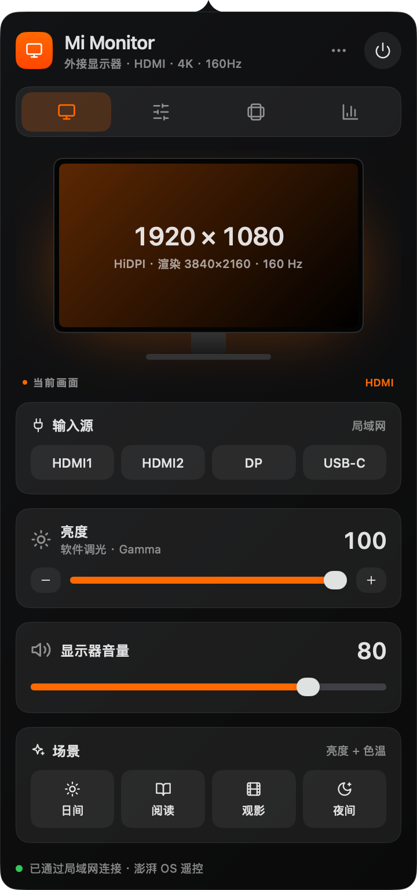
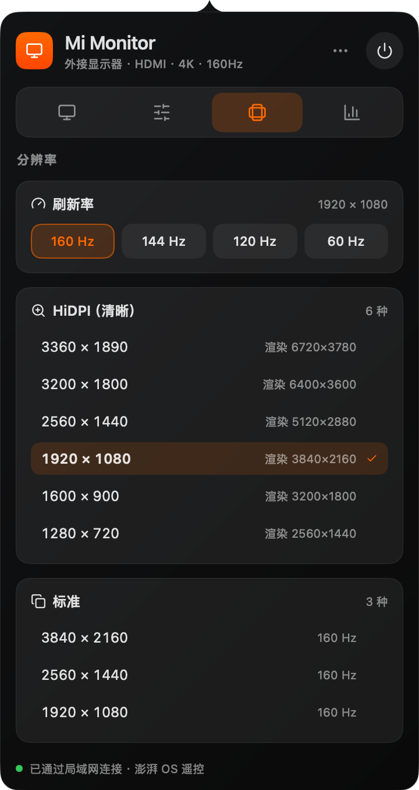
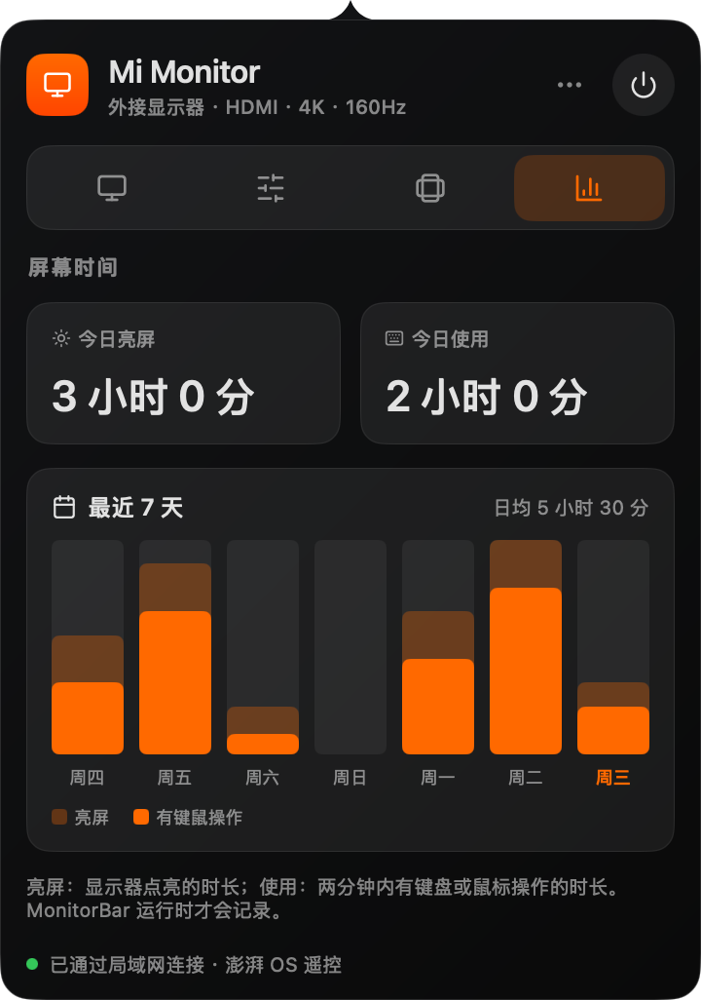
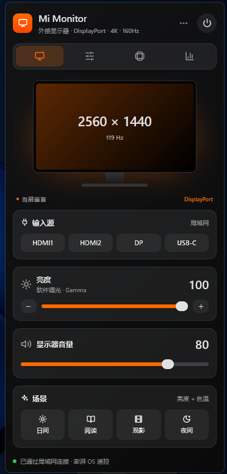

<p align="center"></p>

<h1 align="center">MonitorBar</h1>

<p align="center">macOS 菜单栏 / Windows 托盘里的显示器管理工具，一份 Go 代码，两端原生界面。<br>
A menu bar (macOS) and tray (Windows) app to manage your monitor — <a href="#english">English</a></p>

<p align="center">



</p>

## 功能

| 分页 | 功能 |
| --- | --- |
| 概览 | 当前分辨率与刷新率、**切换输入源**、软件亮度、**显示器音量**、场景（日间 / 阅读 / 观影 / 夜间） |
| 画面 | 场景、软件调光、色温（减少蓝光）、一键恢复 |
| 分辨率 | 刷新率切换，HiDPI（仅 macOS）与标准分辨率列表 |
| 屏幕时间 | 今日亮屏与使用时长，最近 7 天柱状图 |

- **切换输入源、调音量不需要 DDC/CI**：澎湃 OS 显示器（如 REDMI 显示器 G Pro 27U 2026）在局域网提供遥控接口，MonitorBar 自动发现并使用它。Mac 和 Windows 接在同一台显示器的不同接口上时，两边都能一键切到对方。
- **软件调光与色温**通过显卡的 Gamma 表实现，任何连接线、任何显示器都能用。
- 单个可执行文件，无 webview，空闲时不占 CPU；中文界面，深色主题。

## 安装

从 [Releases](https://github.com/binaryify/MonitorBar/releases) 或 [CI 产物](https://github.com/binaryify/MonitorBar/actions) 下载：

- **macOS**（Apple Silicon / Intel，macOS 12+）：打开 `.dmg`，把 MonitorBar 拖进「应用程序」。应用未签名，首次打开需右键 → 打开。第一次连接显示器时允许「查找本地网络上的设备」。
- **Windows 10 / 11**：把 `MonitorBar.exe` 和同目录的 `icon.png` 放到任意文件夹（推荐 `%LOCALAPPDATA%\Programs\MonitorBar`）后运行。托盘图标默认在 `^` 溢出区，可拖到任务栏常驻。

开机自启：面板右上角「⋯」→「登录时启动」，或命令行 `MonitorBar --open-at-login on`（`off` 关闭）。

## 命令行

```bash
MonitorBar --show                 # 启动并打开面板（程序已运行时，再次启动也会打开面板）
MonitorBar --probe                # 打印显示器、接口、模式和局域网发现结果
MonitorBar --open-at-login on     # 开机自启（off 关闭）
```

## 工作原理

- **局域网遥控**：澎湃 OS 的 6095 端口提供 `getsources`（信号源列表）、`changesource2`（按编号切换，能切到 DP / USB-C）、`getvolume`、`keyevent`（遥控按键，音量 ±1）。首次启动扫描所在 /24 网段找到显示器，之后记住地址。
- **macOS**：通过 [purego](https://github.com/ebitengine/purego) 调用 CoreGraphics、IOKit、AppKit（无 cgo）。
- **Windows**：通过 `syscall` 调用 user32、gdi32、powrprof。

## 平台差异

- **软件调光**：Windows 只接受离标准曲线不远的 Gamma（最暗约 50%），更暗时退到允许的最暗并保留色温比例，面板会提示。macOS 无此限制。退出时两端都会恢复原始曲线。
- **亮屏统计**：macOS 读显示器休眠状态；Windows 以「空闲时长 ≥ 电源计划的关闭显示器时间」推断。
- **面板位置**：从溢出区打开时面板贴在图标上方；拿不到图标位置时（如再次启动程序打开）贴在屏幕右下角。
- 数据保存在 `~/Library/Application Support/MonitorBar`（macOS）或 `%APPDATA%\MonitorBar`（Windows）。

<p align="center"><br><sub>Windows 11 上的面板</sub></p>

## 开发

基于 [mygo](https://mygo.egoist.dev/)，需要 Go 1.27+（`go` 会自动下载对应工具链）。

```bash
go tool mygo dev                                         # 开发，改动后自动重启
go test ./...                                            # 无窗口的界面测试与单元测试
MONITORBAR_SNAPSHOTS=docs/screenshots go test -run TestSnapshots .   # 重新生成截图
go tool mygo build -platform darwin/universal,windows/amd64          # 打包两端（可在 Mac 上交叉编译 Windows 版）
```

| 路径 | 职责 |
| --- | --- |
| `main.go` / `app.go` | 入口、托盘图标、弹出面板的尺寸与位置 |
| `store.go` | 状态与动作：只在主线程读写，网络请求在 goroutine 中，结果经 `post` 回到主线程 |
| `panel.go` / `tabs.go` / `widgets.go` / `icons.go` | 界面 |
| `internal/mitv` | 澎湃 OS 局域网接口与发现 |
| `internal/display` | 平台层：显示器信息、分辨率、Gamma、亮屏与空闲时间 |
| `internal/usage` | 屏幕时间，每 30 秒采样，保留 60 天 |

## 致谢

- [mygo](https://github.com/egoist/mygo)：Go 桌面应用框架
- [LGwebOS-menubar](https://github.com/gabrielgreco1/LGwebOS-menubar)：界面设计的灵感来源
- 图标风格参考 [Lucide](https://lucide.dev)

## English

MonitorBar manages an external monitor from the macOS menu bar or the Windows notification area. It switches inputs and changes volume over the LAN remote API of Xiaomi HyperOS monitors (no DDC/CI needed), dims and warms the picture through the gamma table, switches resolutions and refresh rates, and tracks screen time. It is one Go codebase built with [mygo](https://mygo.egoist.dev/), drawing native UI on both platforms; the Windows build cross-compiles from a Mac. See [Development](#开发) for build commands.

## 许可证

[MIT](LICENSE)
